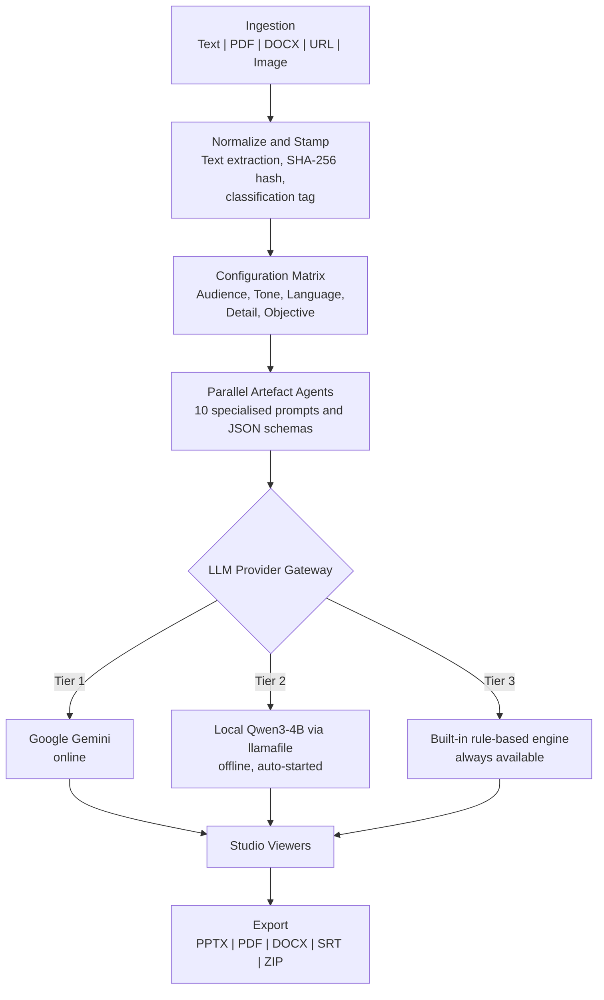
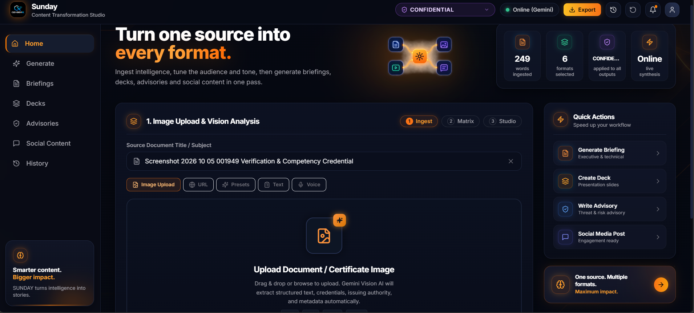

# SUNDAY

### One source. Ten deliverables. An AI engine that keeps working even when the internet doesn't.

**Smart India Hackathon 2026** | Problem Statement ID: **26154** | Team: **CeaserX** (Team ID: **168099**)
Category: Software | Problem: *Gen AI Platform for Automated Content Transformation*

---

## Table of Contents

1. [The Problem](#the-problem)
2. [What SUNDAY Does](#what-sunday-does)
3. [Key Features](#key-features)
4. [Architecture](#architecture)
5. [Never-Fail AI: The 3-Tier Provider Gateway](#never-fail-ai-the-3-tier-provider-gateway)
6. [Tech Stack](#tech-stack)
7. [Project Structure](#project-structure)
8. [Getting Started](#getting-started)
9. [Offline Model Setup (Qwen3-4B)](#offline-model-setup-qwen3-4b)
10. [Demo: Show the Offline Switch](#demo-show-the-offline-switch)
11. [API Reference](#api-reference)
12. [Configuration](#configuration)
13. [Running Tests](#running-tests)
14. [Screenshots](#screenshots)
15. [Known Limitations](#known-limitations)
16. [License](#license)

---

## The Problem

Organisations write one report and then spend hours or days rewriting it by hand into a video script, an executive brief, a slide deck, a press release and social posts. The work is slow, the versions drift apart, and the facts get distorted along the way. Most Gen AI tools also stop working when the internet is down, and they send sensitive documents to the cloud.

## What SUNDAY Does

SUNDAY takes **one source** (pasted text, a PDF or DOCX, a web URL, or an image) and turns it into **up to 10 ready-to-use deliverables** in one click. Every output is reframed for the audience, tone, language and objective you choose.

| # | Deliverable | What you get |
|---|---|---|
| 1 | **Video Package** | Narration script, timed scene storyboard, camera/shot cues, on-screen graphics directions, SRT subtitles |
| 2 | **Advisory** | Advisory ID, CVSS-style scoring, affected systems, MITRE ATT&CK mapping, IOC table, containment checklist |
| 3 | **Infographic** | Key metrics plus Mermaid.js diagram code rendered as SVG in the browser |
| 4 | **Executive Summary** | BLUF (Bottom Line Up Front), key findings, risk matrix, decision items |
| 5 | **Presentation** | Slide-by-slide deck with speaker notes, exportable as real `.pptx` |
| 6 | **Incident SOP** | Step-by-step response procedure with a RACI matrix |
| 7 | **Press Release** | Formal release with quotes and boilerplate |
| 8 | **Whitepaper** | Technical paper with methodology and references |
| 9 | **LinkedIn Post** | Hook, takeaways, call to action, hashtags |
| 10 | **Twitter/X Thread** | Character-bounded multi-post thread |

## Key Features

- **Control matrix:** choose the audience (7 types), tone (6), detail level (3), communication objective (6), style and security classification.
- **Multilingual output:** English, Hindi, Tamil, Telugu, Bengali, Marathi, French, Spanish, German, Russian, Arabic and Japanese.
- **Parallel generation:** all selected deliverables are produced at the same time.
- **Refine drawer:** edit any output in plain language (for example, "make it more urgent").
- **Interactive studio:** slide projector view, text-to-speech voiceover player, live infographic rendering, copy buttons for IOCs.
- **Real exports:** PPTX, PDF, DOCX, SRT, JSON, Markdown and an all-in-one ZIP bundle.
- **Tamper evidence:** each source gets a SHA-256 content hash and an audit stamp (classification, timestamp, operator ID).
- **Resilient by design:** a three-tier AI gateway keeps the app producing output with or without internet.
- **Built-in templates:** sample source documents to try the platform instantly.

## Architecture



## Never-Fail AI: The 3-Tier Provider Gateway

This is the part of SUNDAY that sets it apart. Every AI request goes through one gateway (`backend/app/services/llm_provider.py`):

1. **Tier 1: Google Gemini (online).** Tries `gemini-2.5-flash`, then `gemini-1.5-flash`, then `gemini-1.5-pro`.
2. **Tier 2: Local Qwen3-4B (offline).** If Gemini fails for any reason (no network, bad API key, rate limit, server error), SUNDAY automatically starts a local llamafile server running Qwen3-4B-Thinking on `127.0.0.1:8080` and sends the request there. Reasoning traces are stripped from the output.
3. **Tier 3: Built-in rule-based engine.** If both AI providers are unavailable, a deterministic engine still returns a schema-valid deliverable, so the app never shows an empty screen.

**Self-recovery:** after a Gemini failure, SUNDAY waits 60 seconds (configurable) and then tries Gemini again, so it returns to online mode by itself once connectivity is back.

> The rule-based engine is a safety net, not a replacement for a language model. Quality is highest on Tier 1 and Tier 2.

## Tech Stack

| Layer | Technology |
|---|---|
| Frontend | React 18, Vite, Tailwind CSS, Mermaid.js, Axios, Lucide icons |
| Backend | Python, FastAPI, Pydantic, async I/O, Uvicorn |
| Ingestion | pypdf, python-docx, BeautifulSoup4, Gemini Vision (images) |
| Online AI | Google Gemini API (model cascade) |
| Offline AI | Qwen3-4B-Thinking-2507 (Q4_K_M GGUF) served by llamafile (OpenAI-compatible API) |
| Export | python-pptx, ReportLab, python-docx |
| Deployment | Docker, docker-compose |

## Project Structure

```
Sunday-/
├── backend/
│   ├── app/
│   │   ├── api/            # REST routes: ingest, transform, export, system
│   │   ├── core/           # engine, prompts, rule-based fallback, security/hashing
│   │   ├── models/         # request and response schemas
│   │   ├── services/       # llm_provider, offline_model_manager, ingestion, export, templates
│   │   ├── config.py       # settings (env-driven)
│   │   └── main.py         # FastAPI app, also serves the built frontend
│   ├── offline model/      # llamafile + GGUF go here (not in git, see below)
│   ├── tests/
│   └── requirements.txt
├── frontend/               # React + Vite studio UI
├── deliverables/           # ARCHITECTURE.md
├── Dockerfile
├── docker-compose.yml
├── run_demo.sh             # Linux/macOS one-command launcher
└── README.md
```

## Getting Started

### Prerequisites

- **Python 3.11+**
- **Node.js 18+** (20 recommended) and npm
- *(Optional)* a **Gemini API key** for online mode
- *(Optional)* the offline model files, see [Offline Model Setup](#offline-model-setup-qwen3-4b)

SUNDAY runs without a Gemini key. It will use the offline model if present, or the built-in engine otherwise.

### 1. Clone

```bash
git clone https://github.com/BryanFerns1/Sunday-.git
cd Sunday-
```

### 2. Add your environment file (optional)

Create a file named `.env` in the project root:

```env
GEMINI_API_KEY=your_key_here
```

Never commit this file. It is already listed in `.gitignore`.

### 3A. Run on Windows (PowerShell)

Open two terminals in the project root.

**Terminal 1: backend**

```powershell
python -m venv backend\venv
backend\venv\Scripts\activate
pip install -r backend\requirements.txt
$env:PYTHONPATH = "."
uvicorn backend.app.main:app --host 0.0.0.0 --port 8000
```

**Terminal 2: frontend**

```powershell
cd frontend
npm install
npm run dev
```

Open **http://localhost:3000**. The dev server proxies `/api` calls to the backend on port 8000.

### 3B. Run on Linux / macOS

```bash
chmod +x run_demo.sh
./run_demo.sh
```

The script creates the Python virtual environment, installs dependencies, and starts both servers.

- Frontend: http://localhost:3000
- Backend API docs: http://localhost:8000/docs

### 3C. Run with Docker

```bash
docker compose up --build
```

Open **http://localhost:8000**. The container builds the frontend and serves it from the backend.

> **Docker and the offline model:** the container image does not include the offline model, and the bundled llamafile is a Windows executable. To demonstrate offline mode, run SUNDAY directly on your machine (3A or 3B). In Docker, the platform still works through Gemini and the built-in engine.

## Offline Model Setup (Qwen3-4B)

The model files are large (about 2.4 GB for the model and about 350 MB for llamafile), so they are **not stored in git**. Download them once and place them in `backend/offline model/`:

```
backend/offline model/
├── llamafile-0.10.6.exe
├── qwen3-4b-thinking-2507.Q4_K_M.gguf
└── start.bat        (optional manual launcher)
```

| File | Where to get it |
|---|---|
| `qwen3-4b-thinking-2507.Q4_K_M.gguf` | Hugging Face: search for **Qwen3-4B-Thinking-2507 GGUF** (Q4_K_M quantisation) |
| `llamafile-0.10.6.exe` | Mozilla llamafile releases on GitHub: https://github.com/Mozilla-Ocho/llamafile/releases |

`start.bat` contains one line:

```bat
.\llamafile-0.10.6.exe --server --model qwen3-4b-thinking-2507.Q4_K_M.gguf
```

**You do not need to start it yourself.** When Gemini is unavailable, SUNDAY launches the server automatically, waits for it to become healthy, and routes requests to it. The server log is written to `backend/offline model/llamafile_server.log`.

Hardware: a normal laptop is enough. No GPU is required for the 4-billion-parameter quantised model, though responses are slower than Gemini.

## Demo: Show the Offline Switch

This is the strongest 60 seconds of the demo.

1. Start SUNDAY with a valid `GEMINI_API_KEY` and generate a deliverable. The status shows **Gemini (online)**.
2. **Turn off Wi-Fi** (or disconnect the network cable).
3. Generate another deliverable. SUNDAY detects the Gemini failure and starts the local Qwen model. The first offline response takes longer because the model is loading.
4. Check the active provider at `http://localhost:8000/api/status/model-status`. It should report `offline_qwen`.
5. Turn Wi-Fi back on. After the 60-second cooldown, the next request returns to Gemini automatically.
6. *(Extra)* Stop the offline model and stay offline. The built-in engine still returns valid output.

## API Reference

All routes are available under both `/api` and `/api/v1`. Interactive docs: `http://localhost:8000/docs`.

| Method | Endpoint | Purpose |
|---|---|---|
| `POST` | `/transform` | Generate one or more deliverables from a source |
| `POST` | `/transform/refine` | Refine an existing deliverable with a plain-language instruction |
| `GET` | `/transform/parameters` | Audiences, tones, detail levels, objectives, languages, styles, classifications |
| `GET` | `/transform/formats` | The 10 supported deliverable types |
| `POST` | `/ingest/file` | Extract text from an uploaded file (PDF, DOCX, TXT, etc.) |
| `POST` | `/ingest/upload-image` | Analyse an uploaded image (PNG, JPG, JPEG, WEBP) |
| `POST` | `/ingest/url` | Fetch and extract text from a web page |
| `GET` | `/ingest/templates` | List built-in sample sources |
| `GET` | `/ingest/templates/{template_id}` | Fetch one sample source |
| `POST` | `/export/pptx` | Download the presentation as PowerPoint |
| `POST` | `/export/pdf` | Download a PDF dossier |
| `POST` | `/export/docx` | Download a Word document |
| `POST` | `/export/srt` | Download video subtitles |
| `POST` | `/export/zip` | Download everything as a ZIP bundle |
| `GET` | `/system/health` | Service health and provider configuration |
| `GET` | `/status/model-status` | Active AI provider (`gemini`, `offline_qwen` or `unavailable`) |
| `GET` / `DELETE` | `/system/history` | View or clear the session history |

**Example request**

```bash
curl -X POST http://localhost:8000/api/transform \
  -H "Content-Type: application/json" \
  -d '{
    "source_title": "Grid Incident Report",
    "source_content": "Paste your source text here...",
    "parameters": {
      "selected_formats": ["executive_summary", "linkedin_post", "presentation"],
      "audience": "C-Suite & Leadership",
      "tone": "Authoritative & Formal",
      "language": "English",
      "detail_level": "Standard (Comprehensive Overview)",
      "objective": "Executive Decision Support"
    }
  }'
```

## Configuration

Settings are read from environment variables or a `.env` file in the project root.

| Variable | Default | Description |
|---|---|---|
| `GEMINI_API_KEY` | *(empty)* | Enables online mode (Tier 1) |
| `OPENAI_API_KEY` | *(empty)* | Optional extra provider |
| `OLLAMA_BASE_URL` | `http://localhost:11434` | Optional Ollama endpoint |
| `DEFAULT_MODEL_PROVIDER` | `auto` | Provider mode |
| `EXPORT_DIR` | `/tmp/sunday_exports` | Where generated exports are written |
| `UPLOAD_DIR` | `/tmp/sunday_uploads` | Where uploads are stored |

Offline-model options live in `backend/app/config.py`: `OFFLINE_MODEL_ENABLED` (default on), `OFFLINE_MODEL_HOST` (`127.0.0.1`), `OFFLINE_MODEL_PORT` (`8080`), `OFFLINE_MODEL_STARTUP_TIMEOUT` (10 s) and `GEMINI_COOLDOWN_SEC` (60 s).

## Running Tests

From the project root:

```bash
pip install -r backend/requirements.txt
PYTHONPATH=. pytest backend/tests          # Linux / macOS
```

```powershell
$env:PYTHONPATH = "."; pytest backend\tests   # Windows PowerShell
```

The tests disable real Gemini calls and offline-model spawning, so they run safely on any machine. They cover the transformation pipeline and the Gemini-to-offline fallback logic.

## Screenshots

> Add your screenshots to `docs/screenshots/` and keep these links.

| Home / Ingestion | Configuration Matrix |
|---|---|
|  |  |

| Generation Studio | Offline Mode Active |
|---|---|
|  |  |

## Known Limitations

We list these openly so nobody is surprised during a demo.

- **Offline quality and speed:** Qwen3-4B is smaller and slower than Gemini. It is the resilience tier, not the premium tier.
- **Image analysis offline:** image understanding relies on Gemini Vision. Qwen3-4B is a text-only model, so image analysis is limited when offline.
- **Audio input is a stub:** audio files uploaded through `/ingest/file` currently return a simulated transcript. Real speech-to-text is on the roadmap.
- **Image upload via `/ingest/file`:** uses a placeholder OCR response. Use `/ingest/upload-image` for real vision analysis.
- **Rule-based engine:** produces valid, structured output but it is template-driven rather than generative.
- **Benchmarks:** the speed figures in `deliverables/ARCHITECTURE.md` were measured in rule-based (mock) mode, not with a live language model.
- **Translation:** regional-language output should be reviewed by a native speaker before official release.
- **AI output needs human review.** Use the Refine drawer and verify facts before publishing.

## Roadmap

- Real speech-to-text for audio ingestion
- Offline vision model for image understanding
- Role-based access and persistent audit logs
- Native-speaker validation for regional languages
- More deliverable formats and custom organisation templates

## License

This project is released under the **MIT License**. See [LICENSE](LICENSE) for the full text.

---

**Team CeaserX** | Smart India Hackathon 2026 | Problem Statement 26154
